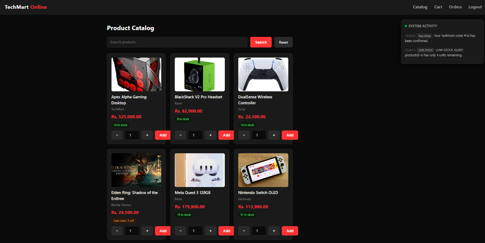
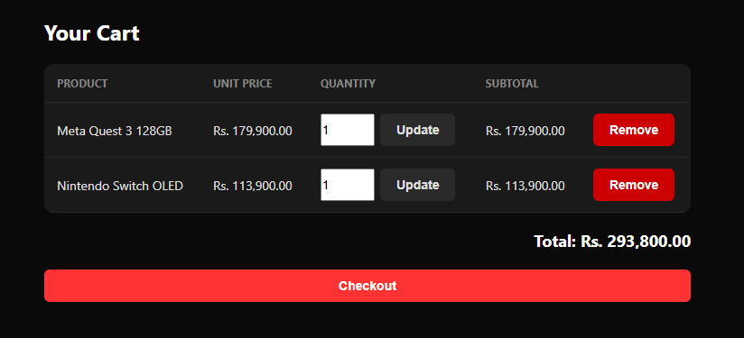
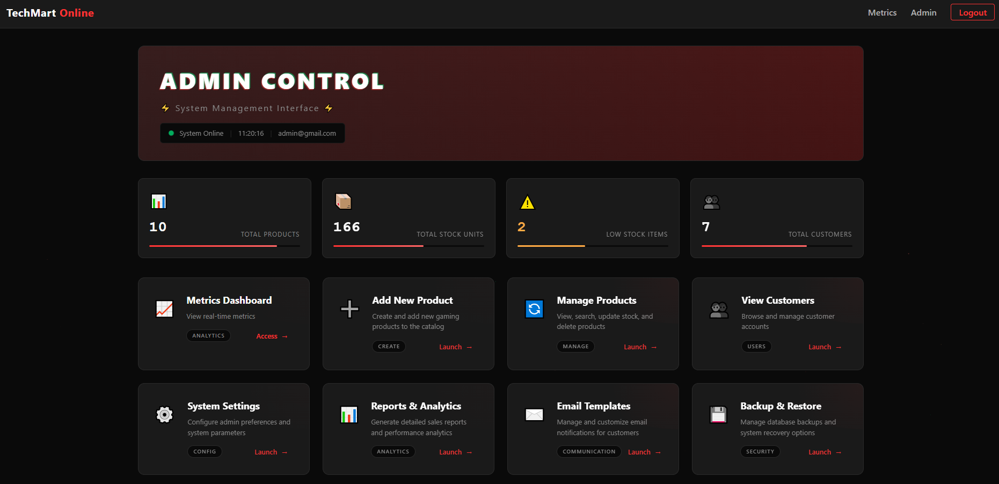
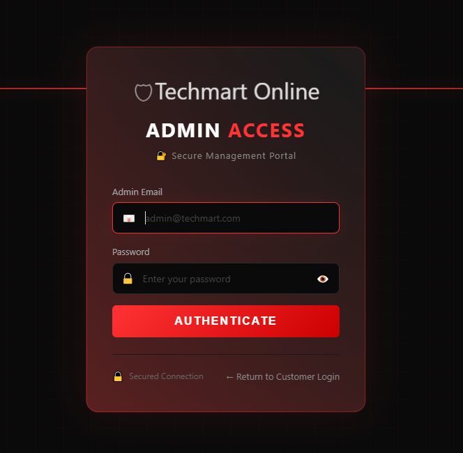
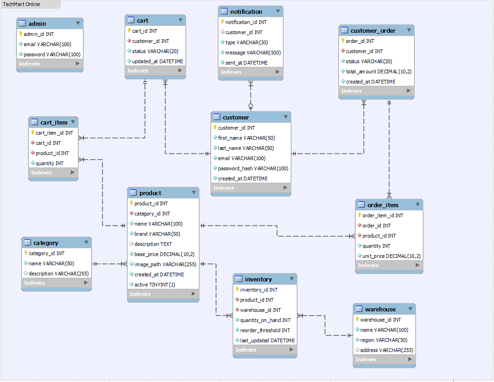

<h1 align="center">🛒 TechMart Online</h1>

  
  
  
  
  

  <strong>TechMart Online</strong> is a full-stack Jakarta EE e-commerce web application for browsing products, managing carts and orders, and administering inventory. It demonstrates enterprise design patterns, JMS asynchronous messaging, and JSP-based server-side rendering.

---

## 📖 Overview

**TechMart Online** is a monolithic, server-rendered Jakarta EE application designed to simulate a real-world e-commerce platform. It handles the complete shopping lifecycle—from product catalog browsing and persistent cart management to checkout processing and order history.

The backend leverages the full power of Jakarta EE, utilizing Stateless, Stateful, Singleton, and Message-Driven EJBs, backed by a MySQL database and asynchronous JMS queues for order processing.

## ✨ Key Features

### 🛍️ Customer Shopping
- Registration, login, and secure session management.
- Dynamic product catalog with category browsing and search.
- Persistent shopping cart (add, update, remove items).
- Seamless checkout process, order history, and pending-order cancellation.

### 📦 Inventory & Admin
- Comprehensive warehouse-based stock management and reorder thresholds.
- **Automated JMS Messaging:** Automatic stock deduction after checkout and low-stock notifications using a JMS Topic.
- Singleton inventory cache for optimized performance.
- Dedicated admin dashboard for product management, customer viewing, and live performance metrics.

### ⚙️ Enterprise Architecture
- **JMS Queues & Topics:** `jms/OrderProcessingQueue` (Checkout) and `jms/LowStockTopic` (Inventory alerts).
- **Asynchronous Processing:** Message-Driven Beans (MDB) and asynchronous EJB methods for order notifications.
- **Web Monitoring:** Custom servlet filters for in-memory request performance tracking and live activity polling.

## 🛠️ Technology Stack

| Category | Technologies |
| :--- | :--- |
| **Backend** | Java 17, Jakarta EE 10, EJB, JMS, JPA, EclipseLink |
| **Frontend** | JSP, JSTL, HTML5, CSS, Vanilla JS, Gson |
| **Database** | MySQL 8.0 (Connector/J 8.4) |
| **Server** | Payara / GlassFish |
| **Testing** | JUnit 5.10, Mockito 5.11, Arquillian, JMeter |

## 📸 System Showcase

| Customer Catalog | Shopping Cart |
| :---: | :---: |
|  |  |

| Admin Dashboard | Admin Login |
| :---: | :---: |
|  |  |

## 🗄️ Database Schema

The database (`techmart_online`) utilizes JPA entities with the following core relationships:

- **Customer** → **Cart** (One-to-One)
- **Customer** → **CustomerOrder** (One-to-Many)
- **Category** → **Product** (One-to-Many)
- **Product** ↔ **Warehouse** (Many-to-Many via `Inventory` entity)
- **Cart** → **CartItem** (One-to-Many)
- **CustomerOrder** → **OrderItem** (One-to-Many)

**Entity-Relationship Diagram:**

  

## 🏗️ System Architecture

1. **Client Layer:** JSP views served to the browser. Interactivity handled via standard HTML forms and limited `fetch()` calls.
2. **Controller Layer (Servlets):** Intercepts HTTP requests, enforces session checks, and routes to EJBs.
3. **Business Layer (EJBs):**
    - *Stateful:* Manages shopping cart state.
    - *Stateless:* Handles business logic (e.g., checkout).
    - *Singleton:* Maintains the inventory cache.
    - *Message-Driven:* Consumes JMS messages for order processing and low-stock alerts.
4. **Data Layer (JPA/EclipseLink):** Manages transactional persistence to MySQL via the `jdbc/TechMartDS` datasource.

## 🚀 Future Enhancements & Known Issues

*(Note: This project was built to explore enterprise patterns. The following are improvements identified for production readiness).*
- [ ] **Security:** Implement BCrypt for password hashing (currently uses direct field comparison).
- [ ] **Security:** Migrate from basic HTTP session auth to JWT or OAuth2.
- [ ] **Infrastructure:** Add Docker configuration and a GitHub Actions CI/CD pipeline.
- [ ] **Testing:** Expand unit test coverage for edge cases in the checkout flow.

## 👨‍💻 Author

**Himansu Nethsara Ranasinghe**
- 🎓 BSc (Hons) Software Engineering Undergraduate (JIAT / BCU)
- 🔗 [LinkedIn](https://www.linkedin.com/in/himansu-nethsara/)
- 🐙 [GitHub](https://github.com/HimansuNethsara)    
